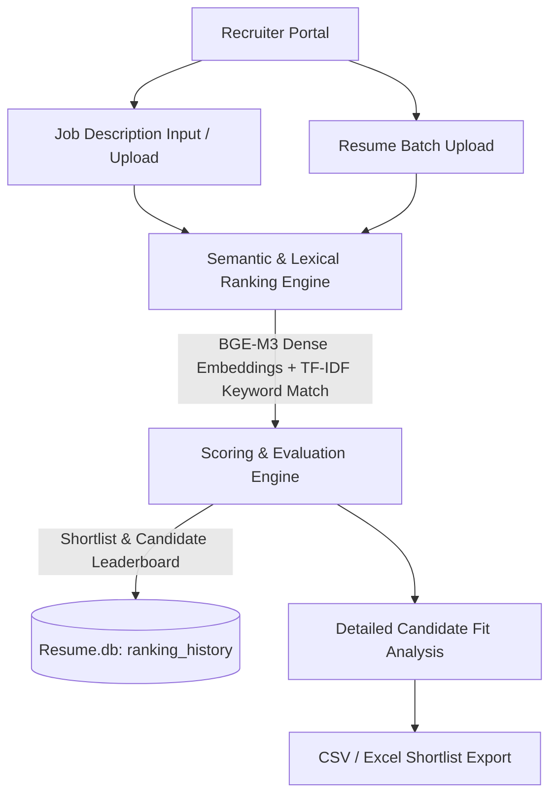

# 🤖 HireSense AI – Intelligent Resume Screening & Ranking Platform

HireSense AI is an intelligent recruitment and talent evaluation suite. It combines **state-of-the-art NLP embedding models (BGE-M3)** for automated resume screening with advanced lexical and semantic matching to rapidly shortlist, evaluate, and rank candidate profiles against detailed job descriptions.

---

## 🚀 Key Modules & Architecture



---

## 🌟 Core Features

### 1. 🚀 Candidate Screening & Semantic Ranking
- **Dense + Lexical Hybrid Matching**: Powered by `BAAI/bge-m3` embeddings combined with TF-IDF/lexical keyword matching.
- **Batch Processing**: Supports multi-PDF and TXT resume uploads, auto-extracts candidate contact info, skills, work experience, and educational background.
- **Explainable Match Scoring**: Breaks down candidate fit across skills match, domain relevance, experience weighting, and education fit.
- **Exportable Shortlists**: One-click export of candidate rankings and score breakdowns to CSV or Microsoft Excel (`.xlsx`).

### 2. 🔐 Recruiter Authentication & History Tracking
- **User Authentication**: Secure recruiter login and registration with hashed password management.
- **Historical Audit Log**: Stores and recalls previous screening sessions and job descriptions in SQLite (`Resume.db`).

---

## 🛠️ Technology Stack

| Layer | Technologies |
|---|---|
| **Recruiter Dashboard** | Python 3.10+, Streamlit, Plotly, Pandas, OpenpyXL |
| **NLP & Ranking Engine** | PyTorch, Sentence-Transformers (`BAAI/bge-m3`), scikit-learn, PyPDF |
| **Database** | SQLite3 (`Resume.db`) |

---

## 📦 Getting Started

### 🔹 1. Prerequisites
- **Python 3.10+** (with virtual environment recommended)

### 🔹 2. Installation
```bash
# Clone the repository
git clone https://github.com/ShreyAsangale29/Resume-screening-NLP
cd Resume-screening-NLP-main

# Set up Python virtual environment
python -m venv .venv
# Windows:
.venv\Scripts\activate
# Linux/macOS:
# source .venv/bin/activate

# Install Python dependencies
pip install -r requirements.txt
```

### 🔹 3. Running the Application

Launch the Streamlit dashboard:
```bash
streamlit run app.py
```

The application will launch in your browser at `http://localhost:8501`.
