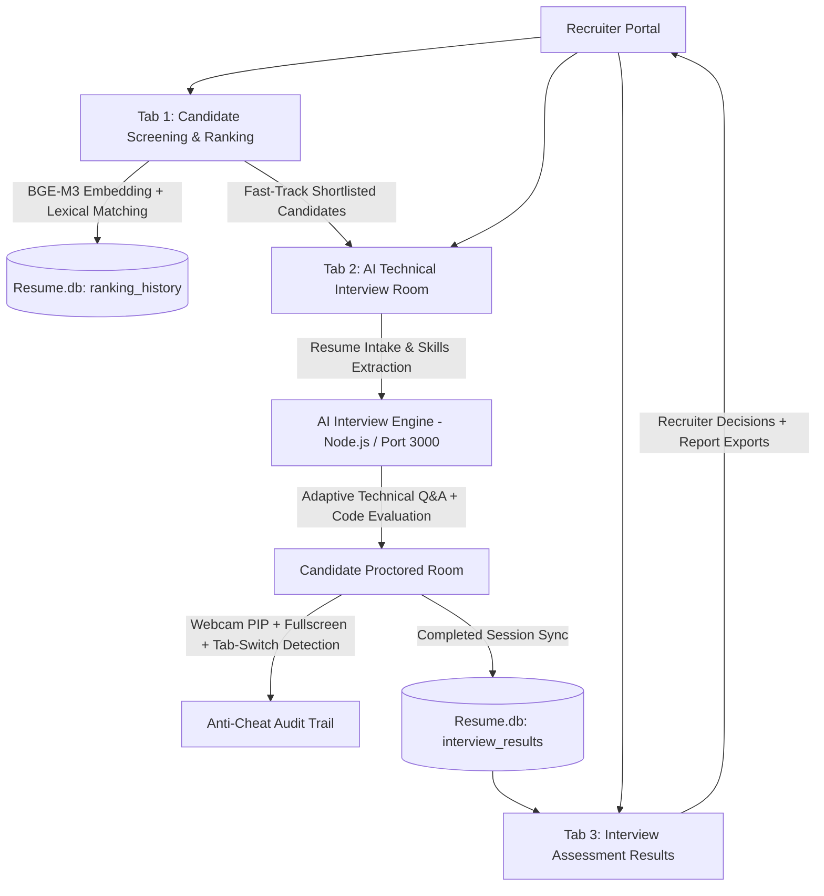

# 🤖 HireSense AI – Intelligent Resume Screening & Proctored Technical Interview Platform

HireSense AI is an end-to-end intelligent recruitment and talent evaluation suite. It combines **state-of-the-art NLP embedding models (BGE-M3)** for automated resume screening with an **adaptive, real-time Proctored AI Technical Interview Room** that conducts in-depth technical evaluations with full anti-cheat integrity enforcement and recruitment audit tracking.

---

## 🚀 Key Modules & Architecture



---

## 🌟 Core Features

### 1. 🚀 Candidate Screening & Semantic Ranking
- **Dense + Lexical Hybrid Matching**: Powered by `BAAI/bge-m3` embeddings combined with TF-IDF/lexical keyword matching.
- **Batch Processing**: Supports multi-PDF resume uploads, auto-extracts skills, work experience, and educational background.
- **Explainable Match Scoring**: Breaks down candidate fit across skills match, domain relevance, and experience weighting.
- **One-Click Fast-Track**: Invite top-ranking candidates directly into the proctored interview room with pre-populated candidate profiles.

### 2. 🎙️ AI Technical Interview Room (Proctored)
- **Resume-First Intake**: Candidates upload their resume (or recruiters select from shortlisted candidates) to extract key focus areas and candidate seniority.
- **Adaptive Multi-Turn Technical Evaluation**: Dynamically calibrates question difficulty across fundamentals, system architecture, coding implementation, and optimization.
- **Comprehensive Anti-Cheat & Proctoring Engine**:
  - 📷 **Live Webcam Picture-in-Picture**: Candidates must grant camera permissions; live proctoring badge displayed throughout the session.
  - 🖥️ **Fullscreen Lock Enforcement**: Blocks leaving full-screen mode, issuing warnings and tracking exit attempts.
  - 👁️ **Tab-Switch & Window-Blur Tracking**: Detects browser tab changes or secondary window focus shifts and logs timestamps into the audit trail.
  - 🚫 **Clipboard & Shortcut Protection**: Disables copy, cut, paste, right-click context menu, and developer tools keyboard shortcuts (`F12`, `Ctrl+Shift+I`).
  - ⚡ **Auto-Terminating Threat Detection**: Automatically alerts candidates and flags suspicious behavior to recruiters.

### 3. 📊 Interview Assessment Results & Recruiter Dashboard
- **Shared SQLite Database (`Resume.db`)**: Concurrently accessed via Python `sqlite3` and Node.js `node:sqlite` (SQLite WAL mode).
- **Candidate Assessment Leaderboard**: Ranks completed interviews by overall score with recommendation tags (`Strong Hire`, `Selected`, `Borderline`, `Rejected`).
- **Deep-Dive Candidate Inspector**:
  - Breakdown across Problem Solving, Technical Depth, System Design, and Communication.
  - 🛡️ **Proctoring & Integrity Audit**: Full timeline of detected tab-switches, fullscreen exits, and window blur incidents.
  - 📝 **Full Q&A Transcripts**: Expandable dialogue turns displaying interviewer questions, candidate answers, and AI grading criteria.
  - ✍️ **Recruiter Decision & Notes**: Change candidate status (`Advance to Next Round`, `Reject`, `Offer Extended`, `Under Review`) with real-time database updates.
  - 📥 **Multi-Format Report Export**: Download candidate dossiers in PDF, HTML, JSON, and formatted TXT.

---

## 🛠️ Technology Stack

| Layer | Technologies |
|---|---|
| **Recruiter Dashboard** | Python 3.10+, Streamlit, Plotly, Pandas |
| **NLP & Ranking Engine** | PyTorch, Sentence-Transformers (`BAAI/bge-m3`), scikit-learn, PyPDF |
| **Interview Engine** | Node.js (v20+ / v22+), Express, WebSocket / SSE, Native `node:sqlite` |
| **Database** | SQLite3 (`Resume.db`) with Concurrent WAL Mode |
| **Client-Side Proctoring** | HTML5 MediaDevices (Webcam), Fullscreen API, Page Visibility API |

---

## 📦 Getting Started

### 🔹 1. Prerequisites
- **Python 3.10+** (with virtual environment recommended)
- **Node.js 20+** or **Node.js 22+**
- Webcam and microphone enabled for proctoring

### 🔹 2. Installation
```bash
# Clone the repository
git clone https://github.com/ShreyAsangale29/Resume-screening-NLP
cd Resume-screening-NLP-main

# Set up Python virtual environment
python -m venv .venv
# Windows:
.venv\Scripts\activate
# Linux/macOS:
# source .venv/bin/activate

# Install Python dependencies
pip install -r requirements.txt
```

### 🔹 3. Running the Application

You can launch both services together or individually:

#### Option A: Streamlit Dashboard (Auto-starts interview engine if needed)
```bash
streamlit run app.py
```
> The dashboard will automatically detect if the AI interview platform on port 3000 is running and provides a quick launch helper.

#### Option B: Launch Interview Platform Manually
```bash
cd Final_Interview_Module/interview-platform
node server.js
```
The interview platform will start listening on `http://localhost:3000`.

---

## 🔐 Security & Proctoring Guidelines for Candidates
When taking an interview:
1. Ensure your webcam is connected and grant browser permission when prompted.
2. The interview will launch in proctored full-screen mode. Do not switch tabs or minimize the browser window.
3. Clipboard operations (copy, paste, cut) and right-clicking are strictly disabled to ensure assessment fairness.
4. Any proctoring incident will be logged in your final evaluation report for the recruiting committee.
