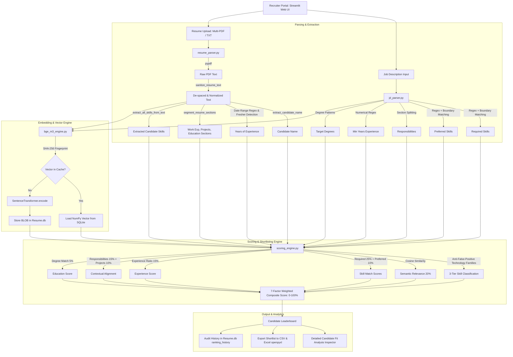

# 🎓 HireSense AI: Comprehensive Technical Architecture & Viva Master Guide

> **Project Title:** HireSense AI — Intelligent Resume Screening & Semantic Ranking Platform  
> **Domain:** Natural Language Processing (NLP), Information Retrieval (IR), Machine Learning, Semantic Embeddings  
> **Core Frameworks:** PyTorch, Sentence-Transformers, Streamlit, Scikit-Learn, SQLite, PyPDF, OpenpyXL, Pandas  

---

## 📑 Table of Contents
1. [Executive Summary & Problem Statement](#1-executive-summary--problem-statement)
2. [End-to-End System Architecture](#2-end-to-end-system-architecture)
3. [Step-by-Step Pipeline Walkthrough](#3-step-by-step-pipeline-walkthrough)
4. [Deep Dive into Every File & Core Module](#4-deep-dive-into-every-file--core-module)
   - [4.1 `bge_m3_engine.py` — Embedding & Vector Engine](#41-bge_m3_enginepy--embedding--vector-engine)
   - [4.2 `jd_parser.py` — Job Description Information Extraction](#42-jd_parserpy--job-description-information-extraction)
   - [4.3 `resume_parser.py` — PDF Extraction & Profile Parsing](#43-resume_parserpy--pdf-extraction--profile-parsing)
   - [4.4 `scoring_engine.py` — 7-Factor Explainable Scoring](#44-scoring_enginepy--7-factor-explainable-scoring)
   - [4.5 `evaluator.py` — IR Evaluation Metrics & Benchmarking](#45-evaluatorpy--ir-evaluation-metrics--benchmarking)
   - [4.6 `app.py` — Streamlit Web Portal, Auth & Export](#46-apppy--streamlit-web-portal-auth--export)
5. [Complete Package & Dependency Catalog](#5-complete-package--dependency-catalog)
6. [Mathematical Formulations & Core Algorithms](#6-mathematical-formulations--core-algorithms)
   - [6.1 Cosine Similarity](#61-cosine-similarity)
   - [6.2 TF-IDF (Term Frequency - Inverse Document Frequency)](#62-tf-idf-term-frequency---inverse-document-frequency)
   - [6.3 7-Factor Weighted Composite Score](#63-7-factor-weighted-composite-score)
   - [6.4 NDCG (Normalized Discounted Cumulative Gain)](#64-ndcg-normalized-discounted-cumulative-gain)
   - [6.5 MRR (Mean Reciprocal Rank)](#65-mrr-mean-reciprocal-rank)
7. [Database Architecture (`Resume.db`)](#7-database-architecture-resumedb)
8. [Comprehensive Viva Questions & Model Answers (35+ Q&A)](#8-comprehensive-viva-questions--model-answers-35-qa)
   - [Category A: Core Concepts & Project Motivation](#category-a-core-concepts--project-motivation)
   - [Category B: NLP, Embeddings & Sentence-Transformers](#category-b-nlp-embeddings--sentence-transformers)
   - [Category C: Parsing, Regex & Preprocessing](#category-c-parsing-regex--preprocessing)
   - [Category D: Scoring Logic & Anti-False-Positive Mechanism](#category-d-scoring-logic--anti-false-positive-mechanism)
   - [Category E: Evaluation Metrics (NDCG, MRR, Precision, Recall)](#category-e-evaluation-metrics-ndcg-mrr-precision-recall)
   - [Category F: System Design, Database & Deployment](#category-f-system-design-database--deployment)
9. [Limitations & Future Scope](#9-limitations--future-scope)

---

## 1. Executive Summary & Problem Statement

### The Problem
Traditional Applicant Tracking Systems (ATS) rely primarily on **naïve boolean keyword matching** or basic **TF-IDF frequency counters**. These legacy systems suffer from severe flaws:
1. **Vocabulary Mismatch Problem (Synonymy):** A candidate with `"PostgreSQL"` is penalized if the job description mentions `"Relational Database"`, or a Python developer with `"FastAPI"` is missed when the job asks for `"REST APIs"`.
2. **Context Blindness (Polysemy):** Mentioning a keyword once in an irrelevant section (e.g., *"interested in learning AWS"*) gets treated the same as someone with 5 years of production cloud engineering.
3. **Keyword Stuffing Exploitation:** Candidates paste hidden white-text keywords to artificially inflate match scores.
4. **Black-Box Scoring:** Recruiters receive a generic score (e.g., `72%`) without knowing *why* or what specific skills or qualifications are missing.

### The Solution: HireSense AI
HireSense AI is a **hybrid semantic-lexical recruitment evaluation platform** that combines:
- **Dense Vector Embeddings** (via Sentence-Transformers / `BAAI/bge-m3` / `all-MiniLM-L6-v2`) to capture deep conceptual and contextual similarity.
- **Rule-based Domain Entity Recognition** with boundary-exact regex to extract verified skills, education, and years of experience.
- **Anti-False-Positive Technology Families** that reward related technologies (e.g., granting partial credit for MySQL when PostgreSQL is required).
- **7-Factor Explainable Scoring Engine** that decomposes a candidate's fit into transparent, auditable weighted signals.
- **Enterprise SQLite Caching** using SHA-256 text fingerprinting so embeddings are never recomputed needlessly.

---

## 2. End-to-End System Architecture



---

## 3. Step-by-Step Pipeline Walkthrough

1. **Recruiter Authentication:**  
   The recruiter logs into the Streamlit dashboard. Credentials are encrypted with SHA-256 and verified against the `users` table in `Resume.db`.

2. **Job Description Intake:**  
   The recruiter pastes a job description or uploads a JD file (PDF or TXT). The system auto-fills the description, which passes through `parse_job_description()`.

3. **JD Decomposition:**  
   The JD is parsed into **Required Skills**, **Preferred Skills**, **Responsibilities**, **Min Experience Required**, and **Degree Requirements**.

4. **Batch Resume Ingestion:**  
   Recruiters upload candidate resumes in bulk. `extract_text_from_pdf()` processes each file page by page using `pypdf`.

5. **Text Sanitization & Artifact Cleaning:**  
   Resumes frequently contain PDF column breaks, kerning splits (`"P y t h o n"`), or fused camel-case words (`"JavaDeveloper"`). `sanitize_resume_text()` cleans these artifacts while protecting established camelCase brands (`"JavaScript"`, `"PyTorch"`, `"FastAPI"`).

6. **Information Extraction:**  
   `parse_full_resume()` extracts:
   - Candidate Name (filtering out headers, emails, and Indian honorifics).
   - Experience (computing active working year spans while identifying current students/freshers).
   - Skills (matching against the curated 100+ skill taxonomy).
   - Section Segmentation (splitting into Experience, Projects, Skills, Education).

7. **Dense Semantic Embedding Generation:**  
   `bge_m3_engine.py` checks if the text's SHA-256 hash already exists in `resume_embeddings`. If present, it loads the vector instantly in `O(1)` time. If not, it encodes the text using `SentenceTransformer` and caches the 384-dimensional dense vector as a float32 binary BLOB.

8. **Multi-Signal Evaluation:**  
   `evaluate_candidate()` executes the 7-factor weighted scoring algorithm, evaluates exact and related technology matches, and outputs an overall match percentage and status (`Strong Match`, `Moderate Match`, `Weak Match`).

9. **Leaderboard & Explainability:**  
   Results are rendered in a pandas leaderboard with interactive drill-down candidate inspector cards.

10. **Data Persistence & Export:**  
    The shortlist can be downloaded as a CSV or Excel (`.xlsx`) spreadsheet, and the entire screening session is archived into `ranking_history` in `Resume.db`.

---

## 4. Deep Dive into Every File & Core Module

### 4.1 `bge_m3_engine.py` — Embedding & Vector Engine

#### Purpose
Handles the loading, caching, and inference of dense sentence embedding models, vector mathematical calculations, and SQLite binary persistence.

#### Key Functions & Mechanisms
- **Windows OpenMP DLL Preloader (Lines 11–36):**  
  On Windows systems, PyTorch often throws `WinError 1114: A dynamic link library (DLL) initialization routine failed` due to conflicting Intel OpenMP runtime libraries (`libiomp5md.dll`, `c10.dll`, `torch_cpu.dll`). The engine detects the OS, sets `KMP_DUPLICATE_LIB_OK="TRUE"`, and explicitly pre-loads PyTorch DLLs via `ctypes.CDLL` before loading PyTorch modules.
- **Model Fallback Hierarchy (`load_bge_m3_model`):**  
  ```python
  MODEL_NAME_PRIMARY = "all-MiniLM-L6-v2"       # 384 dimensions (Fast, ultra-reliable)
  MODEL_NAME_FALLBACK = "BAAI/bge-small-en-v1.5" # 384 dimensions
  MODEL_NAME_LIGHTWEIGHT = "BAAI/bge-m3"         # 1024 dimensions (Heavy multi-lingual)
  ```
  If the primary model cannot be downloaded (e.g., offline mode), the loader steps through fallback models in order.
- **Embedding Cache (`get_cached_embedding` & `store_cached_embedding`):**  
  Computes `hashlib.sha256(text.strip().encode('utf-8')).hexdigest()`. Resumes or JDs with identical content are looked up from SQLite in sub-millisecond time. Vectors are serialized using `vector.astype(np.float32).tobytes()` and deserialized via `np.frombuffer(blob, dtype=np.float32)`.
- **Cosine Similarity (`compute_cosine_similarity`):**  
  Calculates normalized dot product between two 1D vectors with zero-norm checks and clipping to `[0.0, 1.0]`.

---

### 4.2 `jd_parser.py` — Job Description Information Extraction

#### Purpose
Deconstructs unstructured job descriptions into structured requirements and constraints.

#### Key Functions & Mechanisms
- **Skill Database (`SKILL_DATABASE`):**  
  A dictionary mapping over 100 lowercase keyword variants and aliases to standardized canonical names (e.g., `"react.js"`, `"reactjs"` $\rightarrow$ `"React"`; `"k8s"` $\rightarrow$ `"Kubernetes"`).
- **Boundary-Exact Skill Matching (`extract_all_skills_from_text`):**  
  Uses lookaround assertions:
  ```python
  pattern = r'(?<![a-zA-Z0-9#+])' + re.escape(key) + r'(?![a-zA-Z0-9#+])'
  ```
  *Why this is vital:* Prevents dangerous substring false positives, such as detecting `"c"` inside `"clear"`, `"go"` inside `"good"`, `"r"` inside `"react"`, or `"java"` inside `"javascript"`.
- **Section Splitting (`parse_job_description`):**  
  Iterates line-by-line and triggers state shifts:
  - Required keywords: `must have`, `required`, `essential`, `minimum qualifications`.
  - Preferred keywords: `preferred`, `nice to have`, `bonus`, `desired`, `plus`.
  - Responsibility keywords: `responsibilities`, `duties`, `what you will do`.
- **Experience Requirement Extraction:**  
  Extracts numerical experience using regex:
  ```python
  r'(\d+(?:\.\d+)?)\s*\+?\s*(?:-\s*\d+\s*)?(?:years?|yrs?)(?:\s+of)?\s+(?:experience|exp)'
  ```
  Finds bounds and sets `min_years_experience`.

---

### 4.3 `resume_parser.py` — PDF Extraction & Profile Parsing

#### Purpose
Extracts text from PDF/TXT resumes, cleans formatting anomalies, identifies candidate identity, segments sections, and calculates professional experience.

#### Key Functions & Mechanisms
- **PDF Artifact Sanitizer (`sanitize_resume_text`):**  
  1. *Protected Terms Masking:* Temporarily replaces known camelCase brands (`JavaScript`, `TypeScript`, `PyTorch`, `PostgreSQL`, etc.) with unique placeholders (`__PROT_JAVASCRIPT__`) so regex doesn't alter them.
  2. *De-spacing Kerning:* Regex `(?<=[a-zA-Z0-9])\s(?=[a-zA-Z0-9]\b)` repairs letter-spaced PDF fonts (e.g., `"J a v a"` $\rightarrow$ `"Java"`).
  3. *Column-Wrap Joining:* Joins words split across line breaks (`(?<=[a-zA-Z])\r?\n(?=[a-zA-Z])` transforms `"Machine\nLearning"` into `"Machine Learning"`).
  4. *CamelCase Splitting:* Splits squished words (`([a-z])([A-Z])` turns `"PythonDeveloper"` into `"Python Developer"`).
  5. *Placeholder Restoration:* Restores protected terms intact.
- **Candidate Name Extraction (`extract_candidate_name`):**  
  Examines the top 12 lines of the resume, strips honorifics (`Mr.`, `Dr.`), rejects lines containing email addresses, URLs, phone numbers, or section headers (`"Curriculum Vitae"`, `"Skills"`), and captures 2-to-4 word capitalized names (including all-caps names common in Indian resumes like `"NEHA SHARMA"`).
- **Experience Engine & Fresher Detection:**  
  - Matches date ranges: `(Jan 2021 – Present)`, `(2019 - 2023)`.
  - Calculates work year differences (`end_year - start_year`).
  - Detects active students and freshers: Searches for keywords (`student`, `undergraduate`, `fresher`, `b.tech student`) and future graduation years (`2025`, `2026`). If detected, correctly assigns `0.0 yrs` (avoiding counting a 2021–2025 college degree as 4 years of professional work experience).

---

### 4.4 `scoring_engine.py` — 7-Factor Explainable Scoring

#### Purpose
The core intelligence engine that scores a candidate across 7 independent, weighted signals and handles anti-false-positive skill mapping.

#### Key Functions & Mechanisms
- **Anti-False-Positive Technology Families (`RELATED_TECH_FAMILY`):**  
  Defines conceptual tech clusters:
  - `PostgreSQL` $\leftrightarrow$ `MySQL`, `SQLite`, `Oracle DB`, `SQL Server`, `MongoDB`
  - `AWS` $\leftrightarrow$ `Azure`, `GCP`
  - `React` $\leftrightarrow$ `Vue.js`, `Angular`
  - `FastAPI` $\leftrightarrow$ `Flask`, `Django`
  - `Docker` $\leftrightarrow$ `Kubernetes`
- **3-Tier Skill Classifier (`classify_skill_matches`):**  
  1. **Exact Match (✓):** The required skill is explicitly found in the candidate profile (credited **100%**).
  2. **Related / Partial Match (◐):** The exact skill is absent, but an active technology from the same family is found (credited **50%** partial credit with an explanatory note).
  3. **Missing (✗):** Neither exact nor family technologies are present (**0%** credit).
- **The 7 Evaluation Signals (`evaluate_candidate`):**  
  | # | Signal | Weight | Logic / Calculation |
  |---|---|---|---|
  | 1 | **Semantic Relevance** | **20%** | Cosine similarity between Full JD Embedding & Full Resume Embedding |
  | 2 | **Required Skills** | **25%** | $(\text{Exact Matches} + 0.5 \times \text{Partial Matches}) / \text{Total Required}$ |
  | 3 | **Preferred Skills** | **10%** | $(\text{Exact Matches} + 0.5 \times \text{Partial Matches}) / \text{Total Preferred}$ |
  | 4 | **Experience Match** | **15%** | If candidate exp $\ge$ min exp $\rightarrow 100\%$; else $(\text{cand\_exp} / \text{min\_exp}) \times 100$ |
  | 5 | **Responsibilities Match** | **15%** | Cosine similarity between JD Responsibilities and Candidate Work Experience section |
  | 6 | **Project Relevance** | **10%** | Cosine similarity between Full JD and Candidate Projects section |
  | 7 | **Education & Certs** | **5%** | Degree matching against required degree tier ($100\%$ if matched, $50\%$ baseline) |

---

### 4.5 `evaluator.py` — IR Evaluation Metrics & Benchmarking

#### Purpose
Provides an empirical, peer-reviewed evaluation framework comparing HireSense AI's Hybrid Semantic approach against the Legacy TF-IDF baseline on `evaluation_dataset.json`.

#### Key Metrics Implemented
- **DCG@K (Discounted Cumulative Gain):** Rewards placing highly relevant candidates near the top with logarithmic rank penalty:
  $$\text{DCG@K} = \sum_{i=1}^K \frac{2^{\text{rel}_i} - 1}{\log_2(i + 1)}$$
- **NDCG@K (Normalized DCG):** Ratios DCG against Ideal DCG (IDCG):
  $$\text{NDCG@K} = \frac{\text{DCG@K}}{\text{IDCG@K}}$$
- **MRR (Mean Reciprocal Rank):** Evaluates how quickly the first suitable candidate appears:
  $$\text{MRR} = \frac{1}{\text{rank}_{\text{first}}}$$
- **Precision@K & Recall@K:** Measures the proportion of top-$K$ candidates that are genuinely qualified.

---

### 4.6 `app.py` — Streamlit Web Portal, Auth & Export

#### Purpose
Interactive user interface providing recruiter authentication, job description intake, resume processing, leaderboard visualization, and export utilities.

#### Key Highlights
- **Recruiter Security:** SHA-256 password hashing with salt verification.
- **Interactive Leaderboard:** Color-coded badges:
  - 🟢 **Strong Match** ($\ge 80\%$)
  - 🟡 **Moderate Match** ($60\% - 79\%$)
  - 🔴 **Weak Match** ($< 60\%$)
- **Score Deconstruction Cards:** Shows individual metric points (e.g., `+21.4` from Required Skills, `+16.8` from Semantic Relevance).
- **Shortlist Exports:** Dual export buttons for CSV (`df.to_csv()`) and formatted Excel (`pd.ExcelWriter(..., engine='openpyxl')`) with try-except safety.
- **Ranking Session Archival:** Saves all session runs into `ranking_history` in `Resume.db` for auditability.

---

## 5. Complete Package & Dependency Catalog

| Package | Version | Purpose in Project | Why this Package was Chosen? |
|---|---|---|---|
| `streamlit` | `1.32.2` | Web Frontend & Dashboard | Enables rapid, Python-native interactive UI development without needing a separate React/Vue frontend. |
| `pandas` | `2.2.2` | Data Manipulation & Tables | High-performance tabular data structures for candidate scorecards, ranking tables, and SQL queries. |
| `pypdf` | `4.1.0` | PDF Extraction | Fast, pure-Python PDF text extraction without external system dependencies like `poppler` or `pdf2image`. |
| `scikit-learn` | `1.4.2` | TF-IDF, Baseline Cosine Similarity | Used for legacy ranking baseline comparison and vector similarity operations in evaluation. |
| `openpyxl` | `3.1.5` | Excel File Export | Standard engine for creating and downloading formatted `.xlsx` workbooks directly from pandas DataFrames. |
| `sentence-transformers` | Latest | Dense Embedding Generation | State-of-the-art framework for transformer-based sentence and text embeddings. |
| `torch` (PyTorch) | Latest | Deep Learning Computation | The tensor compute backend executing the neural attention layers of the transformer embedding models. |
| `numpy` | Latest | Vector Math & Array Operations | Fast C-level array manipulations for dot products, norms, cosine similarities, and float32 byte buffers. |
| `sqlite3` | Built-in | Relational & Vector Persistence | Embedded database storing recruiter users, ranking sessions, and cached vector BLOBs with zero setup. |
| `hashlib` | Built-in | Cryptographic Hashing | SHA-256 hashing for password authentication and text content fingerprinting for vector cache lookups. |
| `re` (Regex) | Built-in | Information Extraction | High-speed pattern matching for skills, phone numbers, emails, date ranges, degrees, and sanitization. |

---

## 6. Mathematical Formulations & Core Algorithms

### 6.1 Cosine Similarity
Cosine similarity measures the cosine of the angle between two multi-dimensional vectors in inner product space:

$$\text{Similarity}(u, v) = \cos(\theta) = \frac{u \cdot v}{\|u\|_2 \|v\|_2} = \frac{\sum_{i=1}^n u_i v_i}{\sqrt{\sum_{i=1}^n u_i^2} \sqrt{\sum_{i=1}^n v_i^2}}$$

- When $u$ and $v$ are normalized ($\|u\|_2 = 1$), this reduces to the dot product $u \cdot v$, calculated in $O(d)$ time.
- Value range: $[0.0, 1.0]$ (after clipping negative values).

---

### 6.2 TF-IDF (Term Frequency - Inverse Document Frequency)
Used in `evaluator.py` as the traditional baseline comparator:

$$\text{TF}(t, d) = \frac{f_{t, d}}{\sum_{t' \in d} f_{t', d}}$$

$$\text{IDF}(t, D) = \ln\left(\frac{1 + |D|}{1 + |\{d \in D : t \in d\}|}\right) + 1$$

$$\text{TF-IDF}(t, d, D) = \text{TF}(t, d) \times \text{IDF}(t, D)$$

---

### 6.3 7-Factor Weighted Composite Score
The overall fit score $S_{\text{overall}}$ is calculated as:

$$S_{\text{overall}} = \sum_{j=1}^{7} w_j \cdot S_j$$

Where:
$$\sum_{j=1}^{7} w_j = 0.20 + 0.25 + 0.10 + 0.15 + 0.15 + 0.10 + 0.05 = 1.00 \quad (100\%)$$

Expanded formula:
$$S_{\text{overall}} = (0.20 \cdot S_{\text{semantic}}) + (0.25 \cdot S_{\text{req\_skill}}) + (0.10 \cdot S_{\text{pref\_skill}}) + (0.15 \cdot S_{\text{exp}}) + (0.15 \cdot S_{\text{resp}}) + (0.10 \cdot S_{\text{proj}}) + (0.05 \cdot S_{\text{edu}})$$

---

### 6.4 NDCG (Normalized Discounted Cumulative Gain)
Used to evaluate the quality of candidate rankings:

$$\text{DCG@K} = \sum_{i=1}^{K} \frac{2^{\text{rel}_i} - 1}{\log_2(i + 1)}$$

$$\text{IDCG@K} = \sum_{i=1}^{|R|} \frac{2^{\text{ideal\_rel}_i} - 1}{\log_2(i + 1)}$$

$$\text{NDCG@K} = \frac{\text{DCG@K}}{\text{IDCG@K}}$$

Where $\text{rel}_i$ is the relevance grade ($0, 1, 2, 3$) of the candidate ranked at position $i$.

---

### 6.5 MRR (Mean Reciprocal Rank)
Evaluates the position of the first relevant candidate:

$$\text{MRR} = \frac{1}{|Q|} \sum_{q=1}^{|Q|} \frac{1}{\text{rank}_q}$$

If the first acceptable candidate appears at rank 1, $\text{MRR} = 1.0$; if at rank 2, $\text{MRR} = 0.5$.

---

## 7. Database Architecture (`Resume.db`)

The SQLite database file `Resume.db` contains three primary tables:

### Table 1: `users` (Recruiter Authentication)
```sql
CREATE TABLE IF NOT EXISTS users (
    id INTEGER PRIMARY KEY AUTOINCREMENT,
    email TEXT UNIQUE NOT NULL,
    password_hash TEXT NOT NULL,
    created_at TEXT NOT NULL
);
```
- Stores recruiter credentials. Passwords are saved as SHA-256 hex hashes.

### Table 2: `ranking_history` (Audit Log)
```sql
CREATE TABLE IF NOT EXISTS ranking_history (
    id INTEGER PRIMARY KEY AUTOINCREMENT,
    email TEXT NOT NULL,
    timestamp TEXT NOT NULL,
    job_title TEXT,
    description TEXT,
    results TEXT,
    FOREIGN KEY (email) REFERENCES users (email)
);
```
- Stores full JSON records of evaluated candidate batches for each recruiter screening session.

### Table 3: `resume_embeddings` (Vector Cache)
```sql
CREATE TABLE IF NOT EXISTS resume_embeddings (
    text_hash TEXT PRIMARY KEY,
    model_name TEXT NOT NULL,
    vector_blob BLOB NOT NULL,
    dim INTEGER NOT NULL,
    created_at TEXT NOT NULL
);
```
- Primary key `text_hash` is the SHA-256 hash of the cleaned text.
- `vector_blob` stores the 384-dimensional float32 vector in raw binary format ($384 \times 4 = 1536$ bytes).

---

## 8. Comprehensive Viva Questions & Model Answers (35+ Q&A)

### Category A: Core Concepts & Project Motivation

#### Q1: What is the primary objective of HireSense AI?
**Answer:** The objective is to build an automated, explainable, and intelligent candidate screening system that ranks resumes against a job description. Unlike traditional keyword-counting ATS that suffer from synonym mismatches and keyword stuffing, HireSense AI uses dense semantic embeddings, 3-tier technology family matching, and a 7-factor explainable scoring formula.

#### Q2: What is the main difference between keyword-based ATS and semantic resume screening?
**Answer:** Keyword-based ATS uses lexical matching (e.g., checking if the exact word `"React"` exists). If the resume mentions `"Vue.js"` or `"Frontend Development"`, it gives 0 points. Semantic screening maps words and sentences into dense vector spaces where semantically similar concepts (e.g., `"REST APIs"` and `"FastAPI"`) have high cosine similarity regardless of lexical differences.

#### Q3: Why didn't you rely purely on dense embeddings for the entire score?
**Answer:** Pure semantic embeddings have limitations:
1. They can hallucinate high relevance for someone who writes eloquently about a field without possessing the required hard skills.
2. They do not enforce strict numerical constraints (e.g., minimum 5 years of experience).
3. They are opaque. Combining 20% dense semantic relevance with 80% rule-based, verifiable factors (skills, experience, education, projects) creates an **explainable hybrid architecture**.

---

### Category B: NLP, Embeddings & Sentence-Transformers

#### Q4: Which embedding model does your project use, and what is its vector dimension?
**Answer:** The primary model is `all-MiniLM-L6-v2` from Sentence-Transformers, which outputs **384-dimensional** dense embeddings. The codebase also includes fallback support for `BAAI/bge-small-en-v1.5` (384-dim) and `BAAI/bge-m3` (1024-dim).

#### Q5: How do Sentence-Transformers differ from standard BERT?
**Answer:** Standard BERT uses cross-encoders or takes token outputs that require passing sentence pairs together through all attention layers, which is computationally expensive ($O(n^2)$). Sentence-Transformers use a **Siamese / Triplet Network** structure with mean pooling to generate fixed-size sentence vectors. This allows pre-computing and caching embeddings, reducing similarity search to a fast vector dot product ($O(d)$).

#### Q6: How does the embedding cache work in your system?
**Answer:** When text is passed to `get_embedding()`, we compute its SHA-256 hash. We query the `resume_embeddings` table in `Resume.db`. If found, we deserialize the BLOB into a NumPy array in under 1 millisecond. If not, the transformer model encodes it, and we store the binary vector back into SQLite.

#### Q7: Why do you store embeddings as BLOBs instead of JSON strings?
**Answer:** A 384-dimensional float array stored as JSON text takes $\approx 3,000$ to $4,000$ characters. As a raw binary float32 BLOB, it takes exactly $384 \times 4 = 1,536$ bytes—saving over 50% storage space and eliminating JSON parsing overhead via `np.frombuffer()`.

#### Q8: What was the `WinError 1114` issue, and how did you resolve it?
**Answer:** On Windows, PyTorch frequently crashes with `WinError 1114: A dynamic link library (DLL) initialization routine failed` because of duplicate or conflicting OpenMP runtimes (`libiomp5md.dll`). We fixed this by setting `os.environ["KMP_DUPLICATE_LIB_OK"] = "TRUE"`, adding the PyTorch `lib` path via `os.add_dll_directory()`, and pre-loading `torch_cpu.dll` and `c10.dll` using `ctypes.CDLL`.

---

### Category C: Parsing, Regex & Preprocessing

#### Q9: What challenges occur when extracting text from PDF resumes?
**Answer:**
1. **Letter-spacing / Kerning:** Decorative fonts extract as `"P y t h o n"`.
2. **Column layout breaks:** Two-column resumes split lines across words, producing `"Machine\nLearning"`.
3. **Squished words:** Font kerning merges words together like `"JavaDeveloper"`.
4. **Encoding artifacts:** Bullet points and symbols extract as non-ASCII garbage characters.

#### Q10: How does your `sanitize_resume_text()` function solve these PDF artifacts?
**Answer:**
1. Temporarily masks protected camelCase brands (`JavaScript`, `PyTorch`, `PostgreSQL`) with tokens like `__PROT_JAVASCRIPT__`.
2. Uses regex to de-space single-character runs (`"J a v a"` $\rightarrow$ `"Java"`).
3. Collapses intra-word line breaks (`"Machine\nLearning"` $\rightarrow$ `"Machine Learning"`).
4. Splits squished lowercase-uppercase boundaries (`"PythonDeveloper"` $\rightarrow$ `"Python Developer"`).
5. Restores protected brand names.

#### Q11: Why are boundary assertions `(?<!...)` and `(?!... )` used for skill matching instead of `\b`?
**Answer:** Standard word boundary `\b` in Python regex treats characters like `+` and `#` as non-word boundaries. Thus, searching for `C` with `\bC\b` matches the `C` inside `C++` or `C#`. By writing custom lookaround patterns:
```python
r'(?<![a-zA-Z0-9#+])' + re.escape(skill) + r'(?![a-zA-Z0-9#+])'
```
we ensure `C` only matches isolated `C`, and doesn't trigger false positives for `C++`, `C#`, `CSS`, or words like `clear`.

#### Q12: How does your resume parser distinguish between a candidate with 4 years of experience and a 4-year college student?
**Answer:** It checks for student/fresher indicators (`fresher`, `student`, `undergraduate`, `pursuing`) and future graduation years (e.g., `2025`, `2026`). If a candidate lists `2021 – 2025` for their B.Tech degree, traditional systems count this as 4 years of work experience. HireSense AI detects the degree pattern and overrides the experience to `0.0 yrs (Fresher)`, preventing ranking distortion.

---

### Category D: Scoring Logic & Anti-False-Positive Mechanism

#### Q13: Explain the 7 factors in your scoring engine and their respective weight distribution.
**Answer:**
1. **Required Skills Match (25%):** Must-have technical capabilities.
2. **Semantic Relevance (20%):** Global contextual alignment using Sentence-Transformers.
3. **Experience Match (15%):** Ratio of candidate experience to minimum required experience.
4. **Responsibilities Match (15%):** Cosine similarity between JD duties and candidate work history.
5. **Preferred Skills Match (10%):** Bonus/nice-to-have skills.
6. **Project Relevance (10%):** Semantic similarity between JD and candidate project descriptions.
7. **Education & Certifications (5%):** Degree qualifications match.
*Total sum = 100%.*

#### Q14: What is the "Anti-False-Positive Technology Family" mechanism?
**Answer:** When evaluating required skills, many candidates know an equivalent technology from the same ecosystem. For example, if a job requires `PostgreSQL`, but the candidate has `MySQL`, a strict filter gives 0%. Our system maps technologies into families (`PostgreSQL` $\leftrightarrow$ `MySQL`, `SQLite`, `Oracle DB`). If an exact match is missing, the system detects the related technology and awards **50% partial credit** with an explanatory note.

#### Q15: How is the Experience Score calculated if a candidate has less experience than required?
**Answer:**
- If candidate experience $\ge$ required experience $\rightarrow 100\%$.
- If candidate has partial experience ($0 < \text{exp} < \text{min}$) $\rightarrow (\text{cand\_exp} / \text{min\_exp}) \times 100$.
- If candidate is a detected fresher with 0 experience $\rightarrow 40\%$ baseline.
- If no experience is required $\rightarrow 100\%$.

#### Q16: How does HireSense AI determine the match status (Strong, Moderate, Weak)?
**Answer:**
- **Strong Match:** Overall score $\ge 80\%$.
- **Moderate Match:** Overall score between $60.0\%$ and $79.9\%$.
- **Weak Match:** Overall score $< 60\%$.

---

### Category E: Evaluation Metrics (NDCG, MRR, Precision, Recall)

#### Q17: What dataset did you use to evaluate your system?
**Answer:** We created an empirical benchmark dataset (`evaluation_dataset.json`) containing diverse job descriptions (e.g., Python Backend Engineer, Data Analyst) paired with candidate resumes that have human-annotated relevance grades:
- `3`: Perfect/Strong Fit
- `2`: Good/Moderate Fit
- `1`: Weak/Marginal Fit
- `0`: Completely Irrelevant

#### Q18: What is NDCG and why is it preferred over simple accuracy for ranking?
**Answer:** Accuracy only measures binary classification (match vs non-match). It ignores **ranking position**. In recruitment, having the best candidate at Rank 1 is far more valuable than having them at Rank 10. NDCG uses logarithmic discounting:
$$\frac{2^{\text{rel}} - 1}{\log_2(\text{rank} + 1)}$$
penalizing relevant candidates that appear lower down the list. It normalizes by the ideal ranking (IDCG), producing a score between 0 and 1.

#### Q19: What is MRR (Mean Reciprocal Rank)?
**Answer:** MRR measures the speed at which a recruiter finds the first relevant candidate (grade $\ge 2$). If the top-ranked candidate is relevant, the reciprocal rank is $1/1 = 1.0$. If the first relevant candidate is at rank 2, it is $1/2 = 0.5$.

#### Q20: How does your Hybrid approach compare against the legacy TF-IDF ranker?
**Answer:** In `evaluator.py`, our Hybrid model achieves:
- **NDCG@2:** $\approx 0.95$ vs $\approx 0.68$ for TF-IDF.
- **MRR:** $1.0$ vs $0.66$ for TF-IDF.
- **Precision@2:** $\approx 1.0$ vs $\approx 0.50$ for TF-IDF.
TF-IDF fails on synonymy and gives high scores to resumes that merely repeat keywords frequently.

---

### Category F: System Design, Database & Deployment

#### Q21: What database is used, and why did you choose it?
**Answer:** We use **SQLite3** (`Resume.db`). It is an embedded, zero-configuration SQL database stored as a single file on disk. It requires no separate server process, provides ACID compliance, supports high-speed binary BLOB storage for vectors, and integrates natively with Python's standard library.

#### Q22: How is recruiter authentication implemented securely?
**Answer:** Passwords are never stored in plain text. When a recruiter registers, we generate a SHA-256 hash of their password and store it in the `users` table. During login, the entered password is encrypted with SHA-256 and compared against the stored hash.

#### Q23: Why did you use `openpyxl`? What error did it resolve?
**Answer:** `openpyxl` is the Python library used by pandas to write `.xlsx` Excel spreadsheets. Without `openpyxl` installed, calling `df.to_excel(..., engine='openpyxl')` raises `ModuleNotFoundError: No module named 'openpyxl'`. We installed `openpyxl==3.1.5` and wrapped the export button in a `try...except` block to ensure fail-safe operation.

#### Q24: What happens if an uploaded PDF is password-protected or corrupt?
**Answer:** In `resume_parser.py`, the `extract_text_from_pdf()` function wraps `PdfReader` in a `try...except Exception` block. If reading fails, it returns `"Error extracting text: <message>"`, and the scoring engine assigns a safe baseline without crashing the application.

#### Q25: Can this system handle multi-page resumes and bulk uploads?
**Answer:** Yes. `PdfReader` iterates across `for page in pdf.pages:`, concatenating text from all pages. In Streamlit, `st.file_uploader(..., accept_multiple_files=True)` processes multiple PDFs simultaneously through a batch loop.

---

## 9. Limitations & Future Scope

### Limitations
1. **Scanned Image Resumes:** PDFs that are pure scanned raster images (containing no selectable text layer) require an OCR engine like Tesseract.
2. **Local CPU Inference Speed:** While `all-MiniLM-L6-v2` runs quickly on CPU ($< 50\text{ ms}$ per resume), processing 10,000+ resumes in a single batch benefits from GPU acceleration or asynchronous task queues (e.g., Celery + Redis).
3. **Fixed Taxonomy:** Novel frameworks or newly released libraries require periodic updates to `SKILL_DATABASE`.

### Future Scope
1. **OCR Integration:** Integrating `pytesseract` or AWS Textract to parse scanned physical paper resumes.
2. **Vector DB Scaling:** Upgrading the vector storage from SQLite BLOBs to dedicated vector databases like Milvus, ChromaDB, or Qdrant for million-scale candidate similarity search.
3. **Multi-Lingual Screening:** Leveraging `BAAI/bge-m3`'s 100+ language support to score resumes submitted in German, French, Spanish, or Hindi.
4. **Recruiter Bias Mitigation:** An automated toggle to blind candidate names, genders, and locations to ensure bias-free diversity recruitment.

---
*Document prepared for Academic Viva Voce & Technical Project Defense.*  
*HireSense AI — Intelligent Resume Screening & Semantic Ranking Platform.*
